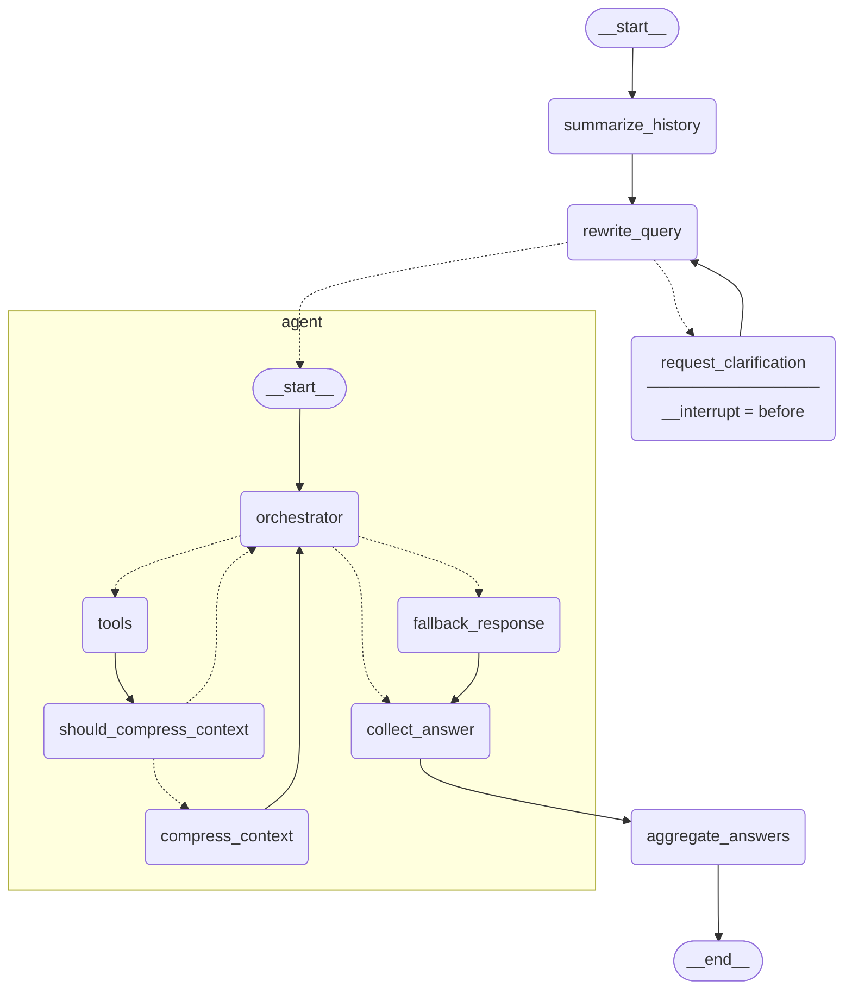

<p align="center">
  
</p>

<h1 align="center">Agentic RAG for Dummies（写给初学者的 Agentic RAG）</h1>

<p align="center">
  <strong>用 LangGraph 构建模块化的 Agentic RAG 系统，带对话记忆与人在回路的查询澄清</strong>
</p>

<p align="center">
  <a href="#概览">概览</a> •
  <a href="#工作原理">工作原理</a> •
  <a href="#llm-提供方配置">LLM 提供方</a> •
  <a href="#实现细节">实现</a> •
  <a href="#安装与使用">安装与使用</a> •
  <a href="#问题排查">问题排查</a>
</p>

<p align="center">
  
  
  
  <a href="https://github.com/von-development/awesome-langgraph">
    
  </a>
</p>

<p align="center">
  
  
  
  
</p>

<p align="center">
  <a href="https://colab.research.google.com/github/GiovanniPasq/agentic-rag-for-dummies/blob/main/notebooks/agentic_rag.ipynb">
    
  </a>
</p>

<p align="center">
  
</p>

<p align="center">
  <strong>如果你喜欢这个项目，点个 star ⭐️ 会很有意义 :)</strong><br>
</p>

> 本文是根目录 `README.md` 的中文翻译副本，供学习参考。原文以英文版为准。

## 概览

本仓库演示了如何用 LangGraph、以极少的代码构建一个 **Agentic RAG（检索增强生成）** 系统。大多数 RAG 教程只讲基础概念，却没有指导如何构建模块化、agent 驱动的系统——本项目正好补上这个缺口，同时提供**学习材料**和**可扩展的架构**。

### 里面有什么

| 特性 | 说明 |
|---|---|
| 🗂️ **分层索引（Hierarchical Indexing）** | 检索小块以求精确，取回大块父块以补上下文 |
| 🧠 **对话记忆** | 跨多轮问题保持上下文，让对话自然 |
| ❓ **查询澄清** | 重写含糊的查询，或暂停下来向用户追问细节 |
| 🤖 **Agent 编排** | LangGraph 统筹整个检索与推理流程 |
| 🔀 **多 Agent Map-Reduce** | 把复杂查询拆成并行的子查询 |
| ✅ **自纠错** | 初次检索结果不足时自动重新检索 |
| 🗜️ **上下文压缩** | 在漫长的检索循环中保持工作记忆精简 |
| 🔍 **可观测性** | 用 Langfuse 跟踪 LLM 调用、工具使用与图的执行 |
| 📊 **评估** | 用 RAGAS 指标评估检索与回答质量 |

### 🎯 两种使用方式

**1️⃣ 学习路径：交互式 Notebook**

逐步讲解的教程，最适合理解核心概念。如果你是 Agentic RAG 新手，或者想快速上手实验，从这里开始。

**2️⃣ 构建路径：模块化项目**

组件之间相互解耦、可独立替换的灵活架构——LLM 提供方、embedding 模型、PDF 转换器、agent 工作流都能换。可运行的 app 默认优先 Ollama，也可以适配 LangChain 支持的任何对话模型提供方。仓库内附有 Anthropic、OpenAI 和 Google 的示例。

参见 [模块化架构](#模块化架构) 与 [安装与使用](#安装与使用) 开始上手。

## 工作原理

### 文档预处理：分层索引

在查询能被处理之前，文档会被切分两次，以获得最佳检索效果：

- **父块（Parent Chunks）**：基于 Markdown 标题（H1、H2、H3）划分的有界大段
- **子块（Child Chunks）**：从父块中切出的、固定尺寸的小片段

> 可选：🐿️ [**Chunky**](https://github.com/GiovanniPasq/chunky) 是一个面向可靠 RAG 流水线的开源工具集：把 PDF 转成 Markdown、清洗文档、检查分块效果、对比不同分块策略，并在构建向量库前丰富元数据。

这样就把**小块用于搜索的精确性**与**大块用于生成的上下文丰富度**结合了起来。

---

### 查询处理：四阶段智能工作流

```
用户提问 → 对话摘要 → 查询重写 → 查询澄清 →
并行 Agent 推理 → 结果聚合 → 最终回答
```

**阶段 1 —— 对话理解：** 维护一份滚动摘要和近期对话历史，既保持连续性，又不会让上下文无限膨胀。

**阶段 2 —— 查询澄清：** 解析指代（"我该怎么更新它？" → "我该怎么更新 SQL？"）、把多部分问题拆成聚焦的子查询、识别不清晰的输入，并重写查询以获得最佳检索效果。需要澄清时会暂停，等待人工输入。

**阶段 3 —— 智能检索（多 Agent Map-Reduce）：** 为每个子查询各派生一个并行的 agent 子图。每个 agent 会检索子块、取回父块补上下文、结果不足时自我纠正、压缩上下文以避免重复获取，并在检索预算耗尽时优雅降级。

> **示例：** *"什么是 JavaScript？什么是 Python？"* → 两个并行 agent 同时执行。

**阶段 4 —— 回答生成：** 把所有 agent 的回答聚合为一段连贯的最终答案。

---

## LLM 提供方配置

本系统与提供方无关：可运行的 app 默认使用 Ollama，而对话模型的初始化可以适配 [LangChain](https://python.langchain.com/docs/integrations/chat/) 中任意可用的 LLM 提供方。下面覆盖最常见的几种，但同一套模式适用于任何其他受支持的提供方。

> **注意：** 模型名变动频繁。部署前请务必查阅官方文档，确认最新可用的模型及其标识符。

### Ollama（本地）

```bash
# 从 https://ollama.com 安装 Ollama
ollama pull granite4.1:8b
```

```python
from langchain_ollama import ChatOllama

llm = ChatOllama(model="granite4.1:8b", temperature=0, seed=42)
```
> ⚠️ 为了可靠的工具调用与指令遵循能力，优先选 **8B 以上**的模型。更小的模型可能忽略检索指令或产生幻觉。参见 [问题排查](#问题排查)。

---

### 云端提供方

<details>
<summary>点击展开</summary>

**OpenAI GPT：**
```bash
pip install -qU langchain-openai
```
```python
from langchain_openai import ChatOpenAI
import os

os.environ["OPENAI_API_KEY"] = "your-api-key-here"
llm = ChatOpenAI(model="gpt-4o-mini", temperature=0)
```

**Anthropic Claude：**
```bash
pip install -qU langchain-anthropic
```
```python
from langchain_anthropic import ChatAnthropic
import os

os.environ["ANTHROPIC_API_KEY"] = "your-api-key-here"
llm = ChatAnthropic(model="claude-sonnet-4-5-20250929", temperature=0)
```

**Google Gemini**
```bash
pip install -qU langchain-google-genai
```
```python
import os
from langchain_google_genai import ChatGoogleGenerativeAI

os.environ["GOOGLE_API_KEY"] = "your-api-key-here"
llm = ChatGoogleGenerativeAI(model="gemini-2.5-flash", temperature=0)
```
</details>

---

## 实现细节

更多细节、扩展讲解与 Langfuse 可观测性内容，见 **[notebook](notebooks/agentic_rag.ipynb)** 与完整项目。配套的 **[评估 notebook](notebooks/evaluation.ipynb)** 会用直接的 RAGAS 指标调用，给最终答案以及 agent 实际使用的子块/父块工具输出打分。

| 步骤 | 说明 |
|------|-------------|
| 1 | [初始设置与配置](#step-1-初始设置与配置) |
| 2 | [配置向量数据库](#step-2-配置向量数据库) |
| 3 | [PDF 转 Markdown](#step-3-pdf-转-markdown) |
| 4 | [文档分层索引](#step-4-文档分层索引) |
| 5 | [定义 Agent 工具](#step-5-定义-agent-工具) |
| 6 | [定义系统提示词](#step-6-定义系统提示词) |
| 7 | [定义状态与数据模型](#step-7-定义状态与数据模型) |
| 8 | [Agent 配置](#step-8-agent-配置) |
| 9 | [构建图的节点与边函数](#step-9-构建图的节点与边函数) |
| 10 | [构建 LangGraph 图](#step-10-构建-langgraph-图) |
| 11 | [创建对话界面](#step-11-创建对话界面) |

### Step 1: 初始设置与配置

定义路径并初始化核心组件。

```python
import os
from pathlib import Path
from langchain_huggingface import HuggingFaceEmbeddings
from langchain_qdrant.fastembed_sparse import FastEmbedSparse
from qdrant_client import QdrantClient

DOCS_DIR = "docs"  # 存放 PDF 文件的目录
MARKDOWN_DIR = "markdown_docs" # 存放转换后的 markdown 的目录
PARENT_STORE_PATH = "parent_store"  # 存放父块 JSON 文件的目录
CHILD_COLLECTION = "document_child_chunks"
DEFAULT_RETRIEVAL_K = 7
CHILD_CHUNK_SEPARATOR = "\n\n<CHILD_CHUNK_BOUNDARY>\n\n"

os.makedirs(DOCS_DIR, exist_ok=True)
os.makedirs(MARKDOWN_DIR, exist_ok=True)
os.makedirs(PARENT_STORE_PATH, exist_ok=True)

from langchain_ollama import ChatOllama
llm = ChatOllama(model="granite4.1:8b", temperature=0, seed=42)

dense_embeddings = HuggingFaceEmbeddings(model_name="Qwen/Qwen3-Embedding-0.6B")
sparse_embeddings = FastEmbedSparse(model_name="Qdrant/bm25")

client = QdrantClient(path="qdrant_db")
```

---

### Step 2: 配置向量数据库

配置 Qdrant 以存储子块，并具备混合检索能力。

```python
from qdrant_client.http import models as qmodels
from langchain_qdrant import QdrantVectorStore
from langchain_qdrant.qdrant import RetrievalMode

embedding_dimension = len(dense_embeddings.embed_query("test"))

def ensure_collection(collection_name):
    if not client.collection_exists(collection_name):
        client.create_collection(
            collection_name=collection_name,
            vectors_config=qmodels.VectorParams(
                size=embedding_dimension,
                distance=qmodels.Distance.COSINE
            ),
            sparse_vectors_config={
                "sparse": qmodels.SparseVectorParams()
            },
        )
```

---

### Step 3: PDF 转 Markdown

把 PDF 转换成 Markdown。关于其他方案的更多细节，见配套的 [notebook](notebooks/pdf_to_markdown.ipynb)。

```python
import os
import pymupdf.layout
import pymupdf4llm
from pathlib import Path
import glob

os.environ["TOKENIZERS_PARALLELISM"] = "false"

def pdf_to_markdown(pdf_path, output_dir):
    doc = pymupdf.open(pdf_path)
    md = pymupdf4llm.to_markdown(doc, header=False, footer=False, page_separators=True, ignore_images=True, write_images=False, image_path=None)
    md_cleaned = md.encode('utf-8', errors='surrogatepass').decode('utf-8', errors='ignore')
    output_path = Path(output_dir) / Path(doc.name).stem
    Path(output_path).with_suffix(".md").write_bytes(md_cleaned.encode('utf-8'))

def pdfs_to_markdowns(path_pattern, overwrite: bool = False):
    output_dir = Path(MARKDOWN_DIR)
    output_dir.mkdir(parents=True, exist_ok=True)

    for pdf_path in map(Path, glob.glob(path_pattern)):
        md_path = (output_dir / pdf_path.stem).with_suffix(".md")
        if overwrite or not md_path.exists():
            pdf_to_markdown(pdf_path, output_dir)

pdfs_to_markdowns(f"{DOCS_DIR}/*.pdf")
```

---

### Step 4: 文档分层索引

用父/子切分策略处理文档。

```python
import os
import glob
import json
from pathlib import Path
from langchain_text_splitters import MarkdownHeaderTextSplitter, RecursiveCharacterTextSplitter
```

<details>
<summary>父块与子块的处理函数</summary>

```python
def merge_metadata(target, source, prepend=False):
    for key, value in source.items():
        if key not in target:
            target[key] = value
        else:
            first, second = (value, target[key]) if prepend else (target[key], value)
            values = [
                item.strip()
                for raw in (first, second)
                for item in str(raw).split(" -> ")
                if item.strip()
            ]
            target[key] = " -> ".join(dict.fromkeys(values))

def merge_small_parents(chunks, min_size):
    if not chunks:
        return []

    merged, current = [], None

    for chunk in chunks:
        if current is None:
            current = chunk
        else:
            current.page_content += "\n\n" + chunk.page_content
            merge_metadata(current.metadata, chunk.metadata)

        if len(current.page_content) >= min_size:
            merged.append(current)
            current = None

    if current:
        if merged:
            merged[-1].page_content += "\n\n" + current.page_content
            merge_metadata(merged[-1].metadata, current.metadata)
        else:
            merged.append(current)

    return merged

def split_large_parents(chunks, max_size, overlap):
    split_chunks = []

    for chunk in chunks:
        if len(chunk.page_content) <= max_size:
            split_chunks.append(chunk)
        else:
            large_splitter = RecursiveCharacterTextSplitter(
                chunk_size=max_size,
                chunk_overlap=overlap
            )
            sub_chunks = large_splitter.split_documents([chunk])
            split_chunks.extend(sub_chunks)

    return split_chunks

def rebalance_pair(first, second, min_size, max_size):
    combined = first.page_content.rstrip() + "\n\n" + second.page_content.lstrip()
    lower = max(1, len(combined) - max_size)
    upper = min(max_size, len(combined) - 1)
    if len(combined) >= 2 * min_size:
        lower = max(lower, min_size)
        upper = min(upper, len(combined) - min_size)
    preferred = min(max(len(combined) // 2, lower), upper)

    split_at = preferred
    for separator in ("\n\n", "\n", " "):
        before = combined.rfind(separator, lower, preferred + 1)
        after = combined.find(separator, preferred, upper + 1)
        if before >= lower:
            split_at = before
            break
        if after != -1:
            split_at = after
            break

    left_text = combined[:split_at].rstrip()
    right_text = combined[split_at:].lstrip()
    if len(combined) >= 2 * min_size and (len(left_text) < min_size or len(right_text) < min_size):
        split_at = preferred
        left_text, right_text = combined[:split_at], combined[split_at:]
    if not left_text or not right_text:
        return first, second

    metadata = dict(first.metadata)
    merge_metadata(metadata, second.metadata)
    first.page_content, first.metadata = left_text, dict(metadata)
    second.page_content, second.metadata = right_text, dict(metadata)
    return first, second

def clean_small_chunks(chunks, min_size, max_size):
    cleaned = []

    for i, chunk in enumerate(chunks):
        if len(chunk.page_content) < min_size:
            if cleaned and len(cleaned[-1].page_content) + 2 + len(chunk.page_content) <= max_size:
                cleaned[-1].page_content += "\n\n" + chunk.page_content
                merge_metadata(cleaned[-1].metadata, chunk.metadata)
            elif i < len(chunks) - 1 and len(chunk.page_content) + 2 + len(chunks[i + 1].page_content) <= max_size:
                chunks[i + 1].page_content = chunk.page_content + "\n\n" + chunks[i + 1].page_content
                merge_metadata(chunks[i + 1].metadata, chunk.metadata, prepend=True)
            else:
                cleaned.append(chunk)
        else:
            cleaned.append(chunk)

    for i, chunk in enumerate(cleaned):
        if len(chunk.page_content) >= min_size or len(cleaned) == 1:
            continue
        if i < len(cleaned) - 1:
            cleaned[i], cleaned[i + 1] = rebalance_pair(chunk, cleaned[i + 1], min_size, max_size)
        else:
            cleaned[i - 1], cleaned[i] = rebalance_pair(cleaned[i - 1], chunk, min_size, max_size)

    return cleaned
```

</details>

```python
if client.collection_exists(CHILD_COLLECTION):
    client.delete_collection(CHILD_COLLECTION)
    ensure_collection(CHILD_COLLECTION)
else:
    ensure_collection(CHILD_COLLECTION)

child_vector_store = QdrantVectorStore(
    client=client,
    collection_name=CHILD_COLLECTION,
    embedding=dense_embeddings,
    sparse_embedding=sparse_embeddings,
    retrieval_mode=RetrievalMode.HYBRID,
    sparse_vector_name="sparse"
)

def index_documents():
    headers_to_split_on = [("#", "H1"), ("##", "H2"), ("###", "H3")]
    parent_splitter = MarkdownHeaderTextSplitter(headers_to_split_on=headers_to_split_on, strip_headers=False)
    child_chunk_size = 500
    child_chunk_overlap = 100
    min_parent_size = 2000
    max_parent_size = 4000
    if min_parent_size <= 0 or max_parent_size < min_parent_size:
        raise ValueError("Parent chunk sizes must be positive and min_parent_size <= max_parent_size.")
    if not 0 <= child_chunk_overlap < child_chunk_size:
        raise ValueError("child_chunk_overlap must be smaller than child_chunk_size.")
    child_splitter = RecursiveCharacterTextSplitter(
        chunk_size=child_chunk_size,
        chunk_overlap=child_chunk_overlap,
    )

    all_parent_pairs, all_child_chunks = [], []
    md_files = sorted(glob.glob(os.path.join(MARKDOWN_DIR, "*.md")))

    if not md_files:
        return

    for doc_path_str in md_files:
        doc_path = Path(doc_path_str)
        try:
            with open(doc_path, "r", encoding="utf-8") as f:
                md_text = f.read()
        except Exception as e:
            continue

        parent_chunks = parent_splitter.split_text(md_text)
        merged_parents = merge_small_parents(parent_chunks, min_parent_size)
        split_parents = split_large_parents(merged_parents, max_parent_size, child_chunk_overlap)
        cleaned_parents = clean_small_chunks(split_parents, min_parent_size, max_parent_size)
        if any(len(chunk.page_content) > max_parent_size for chunk in cleaned_parents):
            raise ValueError("Parent chunking produced an oversized chunk.")

        for i, p_chunk in enumerate(cleaned_parents):
            parent_id = f"{doc_path.stem}_p{i}"
            p_chunk.metadata.update({"source": doc_path.stem + ".pdf", "parent_id": parent_id})
            all_parent_pairs.append((parent_id, p_chunk))
            children = child_splitter.split_documents([p_chunk])
            all_child_chunks.extend(children)

    if not all_child_chunks:
        return

    try:
        child_vector_store.add_documents(all_child_chunks)
    except Exception as e:
        return

    for item in os.listdir(PARENT_STORE_PATH):
        os.remove(os.path.join(PARENT_STORE_PATH, item))

    for parent_id, doc in all_parent_pairs:
        doc_dict = {"page_content": doc.page_content, "metadata": doc.metadata}
        filepath = os.path.join(PARENT_STORE_PATH, f"{parent_id}.json")
        with open(filepath, "w", encoding="utf-8") as f:
            json.dump(doc_dict, f, ensure_ascii=False, indent=2)

index_documents()
```

---

### Step 5: 定义 Agent 工具

创建 agent 将要使用的检索工具。

```python
import json
from typing import List
from langchain_core.tools import tool

RETRIEVAL_SCORE_THRESHOLD = 0.4

@tool
def search_child_chunks(query: str, limit: int = DEFAULT_RETRIEVAL_K) -> str:
    """检索与用户问题相关的文档片段作为证据。

    把这作为第一步检索。返回结果包含父块 ID、文件名和简短的子块片段。
    如果片段相关但过于零碎、无法自信作答，就用返回的 parent_id
    调用 retrieve_parent_chunks。

    参数：
        query: 聚焦的检索查询，带上问题中的具体关键词。
        limit: 最多返回的子块数量。
    """
    try:
        results = child_vector_store.similarity_search(
            query,
            k=limit,
            score_threshold=RETRIEVAL_SCORE_THRESHOLD,
        )
        if not results:
            return "NO_RELEVANT_CHUNKS"

        return CHILD_CHUNK_SEPARATOR.join([
            f"Parent ID: {doc.metadata.get('parent_id', '')}\n"
            f"File Name: {doc.metadata.get('source', '')}\n"
            f"Content: {doc.page_content.strip()}"
            for doc in results
        ])

    except Exception as e:
        return f"RETRIEVAL_ERROR: {str(e)}"

@tool
def retrieve_parent_chunks(parent_id: str) -> str:
    """为一个相关的子块检索结果取回完整的父块。

    只有在 search_child_chunks 返回了相关的 parent_id、且子块片段需要
    更多周边上下文时才使用。不要对已存在于压缩上下文中的父块 ID 调用此工具。

    参数：
        parent_id: 由 search_child_chunks 返回的父块 ID。
    """
    file_name = parent_id if parent_id.lower().endswith(".json") else f"{parent_id}.json"
    path = os.path.join(PARENT_STORE_PATH, file_name)

    if not os.path.exists(path):
        return "NO_PARENT_DOCUMENT"

    with open(path, "r", encoding="utf-8") as f:
        data = json.load(f)

    return (
        f"Parent ID: {parent_id}\n"
        f"File Name: {data.get('metadata', {}).get('source', 'unknown')}\n"
        f"Content: {data.get('page_content', '').strip()}"
    )

llm_with_tools = llm.bind_tools([search_child_chunks, retrieve_parent_chunks])
```

---

### Step 6: 定义系统提示词

定义用于对话摘要、查询重写、agent 编排、上下文压缩、兜底回答与答案聚合的系统提示词。

<details>
<summary>对话摘要提示词</summary>

```python
def get_conversation_summary_prompt() -> str:
    return """## Role
You are a compact memory manager for a retrieval-augmented chat assistant.

## Context
The input contains an existing rolling summary plus older user/assistant messages that will be removed from raw chat history.

## Instructions
- Merge the existing summary with the new older messages.
- Preserve context needed for future follow-up questions: topics, user preferences, important facts, unresolved questions, and referenced source file names.
- Discard greetings, tool calls, tool outputs, formatting chatter, duplicate details, and resolved misunderstandings.
- Keep the summary compact: 30-70 words unless more detail is essential.

## Output
Return exactly one merged summary and nothing else.
Do not include labels such as "Updated summary:", "Previous summary:", or "New messages:".
Do not include both old and new summaries.
If there is no meaningful context, return an empty string.
"""
```

</details>

<details>
<summary>查询重写提示词</summary>

```python
def get_rewrite_query_prompt() -> str:
    return """## Role
You are a query rewriting specialist for document retrieval in a RAG system.

## Instructions
- Rewrite the current query so it is clear, self-contained, and useful for retrieval.
- Use the conversation summary and recent conversation only to resolve vague follow-ups that refer to prior context.
- When an unresolved query and one or more user clarifications are provided, combine all of them into one self-contained retrieval query.
- If the query is a follow-up, integrate only the minimal context needed to make it self-contained.
- Preserve product names, file names, versions, acronyms, numbers, and technical terms exactly.
- If the user asks about a named topic, product, file, acronym, term, or concept, treat the question as clear even if it is new.
- Standalone named terms, acronyms, or concepts are valid retrieval queries; do not require prior conversation context.
- Split only truly separate information needs, with a maximum of 3 rewritten questions.

## Clarification Boundary
Mark the query unclear only when it depends on an unresolved reference such as "it", "that", "this file", or "the previous one".
Do not mark a query unclear because the topic was not mentioned earlier.
Do not ask the user whether a new acronym or term is a typo; preserve it and search for it.

## Constraints
Do not add facts, expand acronyms, invent context, or broaden the user's meaning.
"""
```

</details>

<details>
<summary>编排器（Orchestrator）提示词</summary>

```python
def get_orchestrator_prompt() -> str:
    return """## Role
You are a document-grounded research assistant for an agentic RAG system. Your job is to answer using retrieved document evidence, not general knowledge.

## Available Context
- Current user question
- Optional compressed context from prior retrieval steps
- Tools for searching child chunks and loading full parent chunks

## Tool Guidance
- Search documents before answering unless compressed context already contains enough evidence.
- Use 'search_child_chunks' for missing or uncovered parts of the question.
- If searched or retrieved context is not useful, use the tools again with a different, simpler query or a more relevant parent chunk.
- Continue tool use until the available evidence is enough, tools stop adding useful information, or the operation limit is reached.
- Do not repeat search queries or parent IDs listed in compressed context.
- Do not retrieve the same parent ID twice.

## Response Framework
1. Check compressed context for already-known evidence and already-used searches or parents.
2. Search for missing evidence.
3. Retrieve parent chunks only when child excerpts are relevant but too fragmented.
4. Answer using the exact terms and scope in the retrieved evidence.
5. If evidence is incomplete, state the specific gap.

## Output
- Start directly with the substantive answer. Do not start with generic headings such as "Answer", "Final answer", or "Response".
- Provide the direct answer plus the key supporting details from retrieved evidence; avoid one-sentence fragments unless only one fact is available.
- Do not mention internal tool calls or reasoning.
- When sources exist, end with a Sources section in exactly this format:
  Sources:
  - filename.ext
- Put each source filename on its own bullet line. Never write sources inline, such as "Sources: filename.pdf".
- Do not invent or infer source filenames.
- Strip descriptions after file names, including text in parentheses.
"""
```

</details>

<details>
<summary>兜底回答提示词</summary>

```python
def get_fallback_response_prompt() -> str:
    return """## Role
You are a constrained evidence synthesizer for a retrieval-augmented assistant after the research loop reached its limit.

## Available Context
- Compressed Research Context from earlier retrieval steps
- Retrieved Data from current tool outputs

## Instructions
- Use only explicit facts from the provided context.
- Start directly with the substantive answer. Do not start with generic headings such as "Answer", "Final answer", or "Response".
- Prefer current Retrieved Data over compressed context if they conflict.
- If the answer is incomplete, mention only the missing parts that matter to the user query.
- Do not describe the retrieval process, limits, or internal reasoning.
- Be concise: answer in 1-3 short paragraphs or up to 5 bullets unless the user asks for detail.
- Provide the direct answer plus the key supporting details from retrieved evidence; avoid one-sentence fragments unless only one fact is available.
- End with a Sources section only when actual source file names are explicitly present in the context.
- Use exactly this format:
  Sources:
  - filename.ext
- Put each source filename on its own bullet line. Never write sources inline, such as "Sources: filename.pdf".
- Include only bare file names with extensions such as .pdf, .docx, .txt, or .md.
- Do not invent or infer source filenames.
"""
```

</details>

<details>
<summary>上下文压缩提示词</summary>

```python
def get_context_compression_prompt() -> str:
    return """## Role
You are a research context compressor for an agentic RAG system.

## Instructions
- Keep only facts relevant to answering the user question.
- Preserve exact names, figures, versions, technical terms, configuration details, and source file names.
- Remove duplicates, tool chatter, search query wording, parent IDs, chunk IDs, and other internal identifiers.
- Organize findings by source file. Each source section heading must be the real filename found in retrieved data.
- Add a Gaps section only for missing information relevant to the question.
- Target 400-600 words. If there is too much content, keep the most answer-critical facts.

## Output
Return only Markdown in this structure:
# Research Context Summary

## Focus
[Brief technical restatement of the question]

## Structured Findings
For each source file, add a level-3 heading with its real filename and bullet the directly relevant facts below it.

## Gaps
- Missing or incomplete aspects
"""
```

</details>

<details>
<summary>聚合提示词</summary>

```python
def get_aggregation_prompt() -> str:
    return """## Role
You are a final-answer synthesizer for a retrieval-augmented assistant.

## Instructions
- Use only information present in the retrieved answers.
- Start directly with the substantive answer. Do not start with generic headings such as "Answer", "Final answer", or "Response".
- Preserve important names, numbers, versions, examples, and definitions.
- Do not expand acronyms or interpret terms unless the sources do it.
- If answers conflict, mention the conflict plainly.
- Be concise: answer in 1-3 short paragraphs or up to 5 bullets unless the user asks for detail.
- Provide the direct answer plus the key supporting details from retrieved evidence; avoid one-sentence fragments unless only one fact is available.
- End with a Sources section only when actual source file names are explicitly present in the retrieved answers.
- Use exactly this format:
  Sources:
  - filename.ext
- Put each source filename on its own bullet line. Never write sources inline, such as "Sources: filename.pdf".
- Include only bare file names with extensions such as .pdf, .docx, .txt, or .md.
- Do not invent or infer source filenames.
- If no useful information is available, say: "I couldn't find any information to answer your question in the available sources."
"""
```

</details>

---

### Step 7: 定义状态与数据模型

创建用于对话跟踪与 agent 执行的状态结构。

```python
from langgraph.graph import MessagesState
from pydantic import BaseModel, Field
from typing import List, Annotated, Set
import operator

def accumulate_or_reset(existing: List[dict], new: List[dict]) -> List[dict]:
    if new and any(item.get('__reset__') for item in new):
        return []
    return existing + new

def set_union(a: Set[str], b: Set[str]) -> Set[str]:
    return a | b

def append_unique(existing: List[str], new: List[str]) -> List[str]:
    return list(dict.fromkeys(existing + new))

class State(MessagesState):
    questionIsClear: bool = False
    conversation_summary: str = ""
    originalQuery: str = ""
    pendingQuery: str = ""
    pendingClarifications: List[str] = []
    rewrittenQuestions: List[str] = []
    agent_answers: Annotated[List[dict], accumulate_or_reset] = []

class AgentState(MessagesState):
    tool_call_count: Annotated[int, operator.add] = 0
    iteration_count: Annotated[int, operator.add] = 0
    question: str = ""
    question_index: int = 0
    context_summary: str = ""
    retrieval_keys: Annotated[Set[str], set_union] = set()
    retrieved_contexts: Annotated[List[str], append_unique] = []
    final_answer: str = ""
    agent_answers: List[dict] = []

class QueryAnalysis(BaseModel):
    is_clear: bool = Field(description="Indicates if the user's question is clear and answerable.")
    questions: List[str] = Field(description="List of rewritten, self-contained questions.")
    clarification_needed: str = Field(description="Explanation if the question is unclear.")
```

---

### Step 8: Agent 配置

对工具调用次数与迭代次数施加硬性上限，防止无限循环。token 计数（通过 `tiktoken`）用于驱动上下文压缩的决策。

```python
import tiktoken
from functools import lru_cache

MAX_TOOL_CALLS = 8       # 单次 agent 运行最多调用工具次数
MAX_ITERATIONS = 10      # agent 循环最大迭代次数
BASE_TOKEN_THRESHOLD = 2000     # 触发压缩的初始 token 阈值
TOKEN_GROWTH_FACTOR = 0.9       # 每次压缩后应用的倍率

@lru_cache(maxsize=1)
def _get_token_encoding():
    try:
        return tiktoken.encoding_for_model("gpt-4")
    except Exception:
        try:
            return tiktoken.get_encoding("cl100k_base")
        except Exception:
            return None

def estimate_context_tokens(messages: list) -> int:
    contents = [
        str(msg.content)
        for msg in messages
        if hasattr(msg, "content") and msg.content
    ]
    encoding = _get_token_encoding()
    if encoding is None:
        return sum(max(1, len(content) // 4) for content in contents)
    return sum(len(encoding.encode(content)) for content in contents)
```

---

### Step 9: 构建图的节点与边函数

创建 LangGraph 工作流所需的处理节点与边。

#### 主图的节点与边
```python
from langgraph.types import Send, Command
from langchain_core.messages import HumanMessage, AIMessage, SystemMessage, RemoveMessage, ToolMessage
from typing import Literal, Set

MAIN_HISTORY_MESSAGES_TO_KEEP = 4
if MAIN_HISTORY_MESSAGES_TO_KEEP < 2:
    raise ValueError("MAIN_HISTORY_MESSAGES_TO_KEEP must be at least 2.")
PRE_ANSWER_HISTORY_MESSAGES_TO_KEEP = max(MAIN_HISTORY_MESSAGES_TO_KEEP - 1, 0)

def _is_plain_conversation_message(msg) -> bool:
    return (
        isinstance(msg, (HumanMessage, AIMessage))
        and not getattr(msg, "tool_calls", None)
        and not getattr(msg, "name", None)
    )

def _name_internal_message(message, name):
    """给仅属于子图的消息打标记，使其不被当作对话历史。"""
    return message.model_copy(update={"name": name})

def _retrieval_contexts(messages) -> list[str]:
    contexts = []
    ignored_prefixes = (
        "NO_RELEVANT_CHUNKS",
        "NO_PARENT_DOCUMENT",
        "RETRIEVAL_ERROR:",
        "PARENT_RETRIEVAL_ERROR:",
    )
    for message in messages:
        if not isinstance(message, ToolMessage):
            continue
        content = str(message.content).strip()
        if content and not content.startswith(ignored_prefixes):
            parts = content.split(CHILD_CHUNK_SEPARATOR) if message.name == "search_child_chunks" else [content]
            contexts.extend(part for part in parts if part)
    return list(dict.fromkeys(contexts))

def _format_conversation(messages) -> str:
    lines = []
    for msg in messages:
        role = "User" if isinstance(msg, HumanMessage) else "Assistant"
        lines.append(f"{role}: {msg.content}")
    return "\n".join(lines)

def _remove_messages_not_in(messages, keep_ids):
    removals = []
    for msg in messages:
        msg_id = getattr(msg, "id", None)
        if isinstance(msg, SystemMessage) or not msg_id:
            continue
        if msg_id not in keep_ids:
            removals.append(RemoveMessage(id=msg_id))
    return removals

def _recent_conversation(messages, pending_query="") -> list:
    """返回当前用户消息之前的近期上下文。"""
    plain_messages = [msg for msg in messages if _is_plain_conversation_message(msg)]
    recent_messages = plain_messages[:-1]

    if pending_query:
        for index in range(len(recent_messages) - 1, -1, -1):
            msg = recent_messages[index]
            if isinstance(msg, HumanMessage) and str(msg.content).strip() == pending_query:
                return recent_messages[:index]

    return recent_messages

def summarize_history(state: State):
    messages = state.get("messages", [])
    updates = {"agent_answers": [{"__reset__": True}]}

    if not messages:
        return updates

    plain_messages = [msg for msg in messages if _is_plain_conversation_message(msg)]
    keep_count = PRE_ANSWER_HISTORY_MESSAGES_TO_KEEP
    messages_to_summarize = plain_messages[:-keep_count] if len(plain_messages) > keep_count else []
    keep_ids = {getattr(msg, "id", None) for msg in plain_messages[-keep_count:]}
    keep_ids.discard(None)

    removals = _remove_messages_not_in(messages, keep_ids)
    if removals:
        updates["messages"] = removals

    if not messages_to_summarize:
        return updates

    existing_summary = state.get("conversation_summary", "").strip()
    conversation = "Existing summary:\n"
    conversation += f"{existing_summary or '(none)'}\n\n"
    conversation += "New messages to merge into the summary:\n"
    conversation += _format_conversation(messages_to_summarize)

    summary_response = llm.invoke([
        SystemMessage(content=get_conversation_summary_prompt()),
        HumanMessage(content=conversation),
    ])
    updates["conversation_summary"] = summary_response.content.strip()
    return updates

def rewrite_query(state: State):
    last_message = state["messages"][-1]
    current_query = str(last_message.content).strip()
    conversation_summary = state.get("conversation_summary", "").strip()
    pending_query = state.get("pendingQuery", "").strip()
    pending_clarifications = state.get("pendingClarifications", [])
    recent_messages = _recent_conversation(state["messages"], pending_query)

    context_parts = []
    if conversation_summary:
        context_parts.append(f"Conversation Summary:\n{conversation_summary}")
    if recent_messages:
        context_parts.append(f"Recent Conversation:\n{_format_conversation(recent_messages)}")

    if pending_query:
        clarifications = [*pending_clarifications, current_query]
        clarification_text = "\n".join(
            f"{index}. {value}" for index, value in enumerate(clarifications, start=1)
        )
        context_parts.append(
            f"Unresolved User Query:\n{pending_query}\n\n"
            f"User Clarifications:\n{clarification_text}"
        )
        original_query = f"{pending_query}\nClarifications:\n{clarification_text}"
    else:
        clarifications = []
        context_parts.append(f"User Query:\n{current_query}")
        original_query = current_query

    context_section = "\n\n".join(context_parts)
    llm_with_structure = llm.with_structured_output(QueryAnalysis)
    response = llm_with_structure.invoke([SystemMessage(content=get_rewrite_query_prompt()), HumanMessage(content=context_section)])
    clarification_message_update = (
        [_name_internal_message(last_message, "clarification_response")]
        if pending_query else []
    )

    if response.questions and response.is_clear:
        return {
            "questionIsClear": True,
            "originalQuery": original_query,
            "pendingQuery": "",
            "pendingClarifications": [],
            "rewrittenQuestions": response.questions,
            "messages": clarification_message_update,
        }

    clarification = response.clarification_needed if response.clarification_needed and len(response.clarification_needed.strip()) > 10 else "I need more information to understand your question."
    return {
        "questionIsClear": False,
        "originalQuery": "",
        "pendingQuery": pending_query or current_query,
        "pendingClarifications": clarifications,
        "rewrittenQuestions": [],
        "messages": clarification_message_update + [
            AIMessage(content=clarification, name="clarification")
        ],
    }

def request_clarification(state: State):
    return {}

def route_after_rewrite(state: State) -> Literal["request_clarification", "agent"]:
    if not state.get("questionIsClear", False):
        return "request_clarification"
    else:
        return [
                Send("agent", {"question": query, "question_index": idx, "messages": []})
                for idx, query in enumerate(state["rewrittenQuestions"])
            ]

def aggregate_answers(state: State):
    messages = state.get("messages", [])
    plain_messages = [msg for msg in messages if _is_plain_conversation_message(msg)]
    keep_ids = {getattr(msg, "id", None) for msg in plain_messages[-PRE_ANSWER_HISTORY_MESSAGES_TO_KEEP:]}
    keep_ids.discard(None)
    removals = _remove_messages_not_in(messages, keep_ids)

    if not state.get("agent_answers"):
        return {"messages": removals + [AIMessage(content="No answers were generated.")]}

    sorted_answers = sorted(state["agent_answers"], key=lambda x: x["index"])

    formatted_answers = ""
    for i, ans in enumerate(sorted_answers, start=1):
        formatted_answers += (f"\nRetrieved response {i}:\n"f"{ans['answer']}\n")

    user_message = HumanMessage(content=f"""Original user question: {state["originalQuery"]}\nRetrieved answers:{formatted_answers}""")
    synthesis_response = llm.invoke([SystemMessage(content=get_aggregation_prompt()), user_message])
    return {"messages": removals + [AIMessage(content=synthesis_response.content)]}
```

---

#### Agent 子图的节点与边
```python
def orchestrator(state: AgentState):
    context_summary = state.get("context_summary", "").strip()
    sys_msg = SystemMessage(content=get_orchestrator_prompt())
    summary_injection = (
        [HumanMessage(content=f"[COMPRESSED CONTEXT FROM PRIOR RESEARCH]\n\n{context_summary}")]
        if context_summary else []
    )
    if not state.get("messages"):
        human_msg = HumanMessage(content=state["question"], name="agent_question")
        force_search = HumanMessage(content="YOU MUST CALL 'search_child_chunks' AS THE FIRST STEP TO ANSWER THIS QUESTION.")
        response = llm_with_tools.invoke([sys_msg] + summary_injection + [human_msg, force_search])
        response = _name_internal_message(response, "agent_response")
        return {"messages": [human_msg, response], "tool_call_count": len(response.tool_calls or []), "iteration_count": 1}

    response = llm_with_tools.invoke([sys_msg] + summary_injection + state["messages"])
    response = _name_internal_message(response, "agent_response")
    tool_calls = response.tool_calls if hasattr(response, "tool_calls") else []
    return {"messages": [response], "tool_call_count": len(tool_calls) if tool_calls else 0, "iteration_count": 1}

def route_after_orchestrator_call(state: AgentState) -> Literal["tools", "fallback_response", "collect_answer"]:
    iteration = state.get("iteration_count", 0)
    tool_count = state.get("tool_call_count", 0)

    last_message = state["messages"][-1]
    tool_calls = getattr(last_message, "tool_calls", None) or []

    if not tool_calls:
        return "collect_answer"

    # 在迭代边界处允许产出最终答案，但不执行会超出
    # 已配置研究预算的工具调用。
    if iteration >= MAX_ITERATIONS or tool_count > MAX_TOOL_CALLS:
        return "fallback_response"

    return "tools"

def fallback_response(state: AgentState):
    seen = set()
    unique_contents = []
    for m in state["messages"]:
        if isinstance(m, ToolMessage) and m.content not in seen:
            unique_contents.append(m.content)
            seen.add(m.content)

    context_summary = state.get("context_summary", "").strip()

    context_parts = []
    if context_summary:
        context_parts.append(f"## Compressed Research Context (from prior iterations)\n\n{context_summary}")
    if unique_contents:
        context_parts.append(
            "## Retrieved Data (current iteration)\n\n" +
            "\n\n".join(f"--- DATA SOURCE {i} ---\n{content}" for i, content in enumerate(unique_contents, 1))
        )

    context_text = "\n\n".join(context_parts) if context_parts else "No data was retrieved from the documents."

    prompt_content = (
        f"USER QUERY: {state.get('question')}\n\n"
        f"{context_text}\n\n"
        f"INSTRUCTION:\nProvide the best possible answer using only the data above."
    )
    response = llm.invoke([SystemMessage(content=get_fallback_response_prompt()), HumanMessage(content=prompt_content)])
    response = _name_internal_message(response, "agent_response")
    return {"messages": [response]}

def should_compress_context(state: AgentState) -> Command[Literal["compress_context", "orchestrator"]]:
    messages = state["messages"]

    new_ids: Set[str] = set()
    for msg in reversed(messages):
        if isinstance(msg, AIMessage) and getattr(msg, "tool_calls", None):
            for tc in msg.tool_calls:
                if tc["name"] == "retrieve_parent_chunks":
                    raw = tc["args"].get("parent_id") or tc["args"].get("id") or tc["args"].get("ids") or []
                    if isinstance(raw, str):
                        new_ids.add(f"parent::{raw}")
                    else:
                        new_ids.update(f"parent::{r}" for r in raw)

                elif tc["name"] == "search_child_chunks":
                    query = tc["args"].get("query", "")
                    if query:
                        new_ids.add(f"search::{query}")
            break

    updated_ids = state.get("retrieval_keys", set()) | new_ids

    current_token_messages = estimate_context_tokens(messages)
    current_token_summary = estimate_context_tokens([HumanMessage(content=state.get("context_summary", ""))])
    current_tokens = current_token_messages + current_token_summary

    max_allowed = BASE_TOKEN_THRESHOLD + int(current_token_summary * TOKEN_GROWTH_FACTOR)

    goto = "compress_context" if current_tokens > max_allowed else "orchestrator"
    return Command(
        update={
            "retrieval_keys": updated_ids,
            "retrieved_contexts": _retrieval_contexts(messages),
        },
        goto=goto,
    )

def compress_context(state: AgentState):
    messages = state["messages"]
    existing_summary = state.get("context_summary", "").strip()

    if not messages:
        return {}

    conversation_text = f"USER QUESTION:\n{state.get('question')}\n\nConversation to compress:\n\n"
    if existing_summary:
        conversation_text += f"[PRIOR COMPRESSED CONTEXT]\n{existing_summary}\n\n"

    for msg in messages[1:]:
        if isinstance(msg, AIMessage):
            tool_calls_info = ""
            if getattr(msg, "tool_calls", None):
                calls = ", ".join(f"{tc['name']}({tc['args']})" for tc in msg.tool_calls)
                tool_calls_info = f" | Tool calls: {calls}"
            conversation_text += f"[ASSISTANT{tool_calls_info}]\n{msg.content or '(tool call only)'}\n\n"
        elif isinstance(msg, ToolMessage):
            tool_name = getattr(msg, "name", "tool")
            conversation_text += f"[TOOL RESULT — {tool_name}]\n{msg.content}\n\n"

    summary_response = llm.invoke([SystemMessage(content=get_context_compression_prompt()), HumanMessage(content=conversation_text)])
    new_summary = summary_response.content

    retrieved_ids: Set[str] = state.get("retrieval_keys", set())
    if retrieved_ids:
        parent_ids = sorted(r for r in retrieved_ids if r.startswith("parent::"))
        search_queries = sorted(r.replace("search::", "") for r in retrieved_ids if r.startswith("search::"))

        block = "\n\n---\n**Already executed (do NOT repeat):**\n"
        if parent_ids:
            block += "Parent chunks retrieved:\n" + "\n".join(f"- {p.replace('parent::', '')}" for p in parent_ids) + "\n"
        if search_queries:
            block += "Search queries already run:\n" + "\n".join(f"- {q}" for q in search_queries) + "\n"
        new_summary += block

    return {"context_summary": new_summary, "messages": [RemoveMessage(id=m.id) for m in messages[1:]]}

def collect_answer(state: AgentState):
    last_message = state["messages"][-1]
    is_valid = isinstance(last_message, AIMessage) and last_message.content and not last_message.tool_calls
    answer = last_message.content if is_valid else "Unable to generate an answer."
    return {
        "final_answer": answer,
        "agent_answers": [{
            "index": state["question_index"],
            "question": state["question"],
            "answer": answer,
            "contexts": state.get("retrieved_contexts", []),
        }]
    }
```

**为什么用这套架构？**
- **摘要（Summarization）** 在不让 LLM 上下文过载的前提下维持对话上下文
- **查询重写** 让检索查询精确无歧义，并智能利用上下文
- **人在回路** 在浪费任何检索资源之前就拦住不清晰的查询
- **并行执行** 通过 `Send` API 为每个子问题同时派生独立的 agent 子图
- **上下文压缩** 在漫长的检索循环中保持 agent 工作记忆精简，避免重复获取
- **兜底回答** 确保优雅降级——即使预算耗尽，agent 也总能返回有用的东西
- **答案收集与聚合** 从各 agent 中提取干净的最终答案，并聚合成一段连贯的回复
---

### Step 10: 构建 LangGraph 图

组装完整的工作流图，包含对话记忆与多 Agent 架构。

<details>
<summary>架构流程图</summary>



</details>

```python
from langgraph.graph import START, END, StateGraph
from langgraph.prebuilt import ToolNode
from langgraph.checkpoint.memory import InMemorySaver

checkpointer = InMemorySaver()

agent_builder = StateGraph(AgentState)
agent_builder.add_node(orchestrator)
agent_builder.add_node("tools", ToolNode([search_child_chunks, retrieve_parent_chunks]))
agent_builder.add_node(compress_context)
agent_builder.add_node(fallback_response)
agent_builder.add_node(should_compress_context)
agent_builder.add_node(collect_answer)

agent_builder.add_edge(START, "orchestrator")
agent_builder.add_conditional_edges("orchestrator", route_after_orchestrator_call, {"tools": "tools", "fallback_response": "fallback_response", "collect_answer": "collect_answer"})
agent_builder.add_edge("tools", "should_compress_context")
agent_builder.add_edge("compress_context", "orchestrator")
agent_builder.add_edge("fallback_response", "collect_answer")
agent_builder.add_edge("collect_answer", END)
agent_subgraph = agent_builder.compile()

graph_builder = StateGraph(State)
graph_builder.add_node(summarize_history)
graph_builder.add_node(rewrite_query)
graph_builder.add_node(request_clarification)
graph_builder.add_node("agent", agent_subgraph)
graph_builder.add_node(aggregate_answers)

graph_builder.add_edge(START, "summarize_history")
graph_builder.add_edge("summarize_history", "rewrite_query")
graph_builder.add_conditional_edges("rewrite_query", route_after_rewrite)
graph_builder.add_edge("request_clarification", "rewrite_query")
graph_builder.add_edge(["agent"], "aggregate_answers")
graph_builder.add_edge("aggregate_answers", END)

agent_graph = graph_builder.compile(checkpointer=checkpointer, interrupt_before=["request_clarification"])
```

**图架构说明：**

**Agent 子图**（处理单个问题）：
- START → `orchestrator`（带着工具调用 LLM）
- `orchestrator` → `tools`（需要调用工具时）或 `fallback_response`（预算耗尽）或 `collect_answer`（已完成）
- `tools` → `should_compress_context`（检查 token 预算）
- `should_compress_context` → `compress_context`（超过阈值）或 `orchestrator`（否则）
- `compress_context` → `orchestrator`（带着压缩后的记忆继续）
- `fallback_response` → `collect_answer`（打包尽力而为的答案）
- `collect_answer` → END（带索引的干净最终答案）

**主图**（统筹整个工作流）：
- START → `summarize_history`（把较早的对话滚入摘要，只保留近期往来）
- `summarize_history` → `rewrite_query`（结合上下文重写查询、判断是否清晰）
- `rewrite_query` → `request_clarification`（不清晰时）或通过 `Send` 派生并行 `agent` 子图（清晰时）
- `request_clarification` → `rewrite_query`（用户补充澄清后）
- 所有 `agent` 子图 → `aggregate_answers`（合并全部回答）
- `aggregate_answers` → END（返回最终合成的答案）

---

### Step 11: 创建对话界面

构建一个带对话持久化与人在回路支持的 Gradio 界面。若需要包含文档入库的完整端到端流水线 Gradio 界面，请参考 [project/README.md](./project/README.md)。

> **注意：** notebook 与完整项目会流式输出最终聚合答案，同时把查询分析与工具活动放在各自可折叠的区块中展示。编排器、压缩与兜底模型的原始输出保持内部可见。下面的示例刻意写得极简。

```python
import gradio as gr
import uuid

def create_thread_id():
    """为每次对话生成唯一的 thread ID"""
    return {"configurable": {"thread_id": str(uuid.uuid4())}, "recursion_limit": 50}

def clear_session():
    """为新对话清空 thread"""
    global config
    agent_graph.checkpointer.delete_thread(config["configurable"]["thread_id"])
    config = create_thread_id()

def chat(message, history):
    current_state = agent_graph.get_state(config)

    if current_state.next:
        agent_graph.update_state(config,{"messages": [HumanMessage(content=message.strip())]})
        result = agent_graph.invoke(None, config)
    else:
        result = agent_graph.invoke({"messages": [HumanMessage(content=message.strip())]}, config)

    return result['messages'][-1].content

config = create_thread_id()

with gr.Blocks() as demo:
    chatbot = gr.Chatbot()
    chatbot.clear(clear_session)
    gr.ChatInterface(fn=chat, chatbot=chatbot)

demo.launch(theme=gr.themes.Citrus())
```

**你搞定了！** 现在你已经拥有一个功能完整的 Agentic RAG 系统，具备对话记忆、分层索引与人在回路的查询澄清。

---

## 模块化架构

app（`project/` 目录）被组织成若干模块化组件——每个都可以独立替换而不破坏系统。

### 📂 项目结构
```
project/
├── app.py                    # Gradio 应用主入口
├── config.py                 # 配置中枢（模型、块尺寸、提供方）
├── core/                     # RAG 系统编排
├── db/                       # 向量数据库与父块存储
├── rag_agent/                # LangGraph 工作流（节点、边、提示词、工具）
└── ui/                       # Gradio 界面
```

关键的可定制点：LLM 提供方、embedding 模型、分块策略、agent 工作流与系统提示词——都能通过 `config.py` 或各自的模块来配置。

完整文档见 [project/README.md](./project/README.md)。

## 安装与使用

示例 PDF 文件可在此获取：[javascript](https://www.tutorialspoint.com/javascript/javascript_tutorial.pdf)、[blockchain](https://blockchain-observatory.ec.europa.eu/document/download/1063effa-59cc-4df4-aeee-d2cf94f69178_en?filename=Blockchain_For_Beginners_A_EUBOF_Guide.pdf)、[fortinet](https://www.commoncriteriaportal.org/files/epfiles/Fortinet%20FortiGate_EAL4_ST_V1.5.pdf(320893)_TMP.pdf)。

### 方式 1：快速上手 Notebook（推荐用于测试）

**Google Colab：** notebook 会自行克隆仓库并安装依赖。把你的 PDF 上传到 `docs/`。标准托管版 Colab 不提供 Ollama，因此在运行其余单元格之前，请先把默认的 Ollama 模型单元格替换为文档中列出的某个云端提供方示例。

**本地（Jupyter/VSCode）：** 可选地创建并激活虚拟环境，用 `pip install -r requirements.txt` 或 `uv pip install -r requirements.txt` 安装依赖，把 PDF 放进 `docs/`，然后从上到下依次运行所有单元格。

对话界面会在最后出现。

### 方式 2：完整 Python 项目（推荐用于开发）

#### 1. 安装依赖
```bash
# 克隆仓库
git clone https://github.com/GiovanniPasq/agentic-rag-for-dummies
cd agentic-rag-for-dummies

# 方案 A：pip
python -m venv .venv && source .venv/bin/activate
pip install -r requirements.txt

# 方案 B：uv
uv venv .venv
source .venv/bin/activate  # Windows: .venv\Scripts\activate
uv pip install -r requirements.txt
```

#### 2. 运行应用
```bash
python project/app.py
```

#### 3. 开始提问

打开本地地址（例如 `http://127.0.0.1:7860`）即可开始对话。

---

### 方式 3：Docker 部署

完整的 Docker 说明与系统要求见 [`project/README.md`](./project/README.md#Docker-Deployment)。

### 示例对话

**带对话记忆：**
```
用户："我该怎么安装 SQL？"
Agent：[根据文档提供安装步骤]

用户："我该怎么更新它？"
Agent：[理解 "它" = SQL，给出更新说明]
```

**带查询澄清：**
```
用户："给我讲讲那个东西"
Agent："我需要更多信息。你想问的具体是哪个主题？"

用户："PostgreSQL 的安装流程"
Agent：[检索并给出具体信息]
```

---

## 问题排查

| 领域 | 常见问题 | 建议解决方案 |
|------|----------------|------------------|
| **模型选择** | - 回答忽略指令<br>- 工具（检索/搜索）使用不正确<br>- 上下文理解差<br>- 幻觉或聚合不完整 | - 换用能力更强的 LLM<br>- 优先选 8B 以上的模型以获得更好推理<br>- 本地模型受限时考虑云端模型 |
| **系统提示词行为** | - 模型不检索文档直接作答<br>- 查询重写丢失上下文<br>- 聚合引入幻觉 | - 在系统提示词中把"必须检索"写明确<br>- 让查询重写紧贴用户原意 |
| **检索配置** | - 检索不到相关文档<br>- 无关信息太多 | - 调大检索块数（`k`）或降低相似度阈值以提高召回<br>- 调小 `k` 或提高阈值以提高精确度 |
| **块尺寸 / 文档切分** | - 回答缺少上下文或显得零碎<br>- 检索慢或 embedding 成本高 | - 增大块与父块尺寸以获得更多上下文<br>- 减小块尺寸以提速并降低成本 |
| **上下文压缩** | - 压缩后 agent 丢失重要细节<br>- 压缩摘要过于含糊 | - 调整压缩的系统提示词<br>- 调高 `BASE_TOKEN_THRESHOLD` 以推迟压缩<br>- 调高 `TOKEN_GROWTH_FACTOR` |
| **Agent 配置** | - agent 过早放弃<br>- agent 循环太久 | - 对复杂查询调高 `MAX_TOOL_CALLS` / `MAX_ITERATIONS`<br>- 调低它们以加速简单查询 |
| **温度与一致性** | - 回答不一致或过于发散<br>- 回答过于死板或重复 | - 把 temperature 设为 `0` 以获得事实性、稳定的输出<br>- 在摘要或分析类任务中略微调高 temperature |
| **Embedding 模型质量** | - 语义检索效果差<br>- 在特定领域或多语言文档上表现弱 | - 换质量更高或领域专用的 embedding<br>- 更换 embedding 后必须重新索引全部文档 |

> 💡 **更多排查技巧** 见 [README 问题排查](./project/README.md#troubleshooting)。
